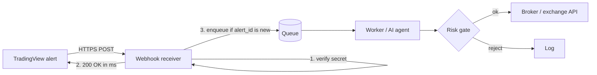
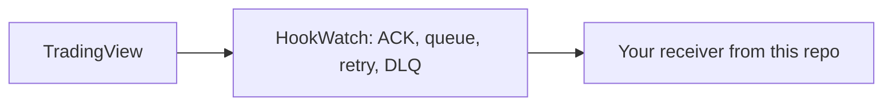

# tradingview-webhook-examples

Minimal, copy-pasteable receivers for **TradingView webhook alerts** in Python (FastAPI) and Node (Express), plus an example that hands signals to an **AI trading agent** through a queue.

> Maintained by [HookWatch](https://gethookwatch.com), a hosted webhook reliability layer for TradingView alerts. Everything here works **without** HookWatch; the DIY section below shows how. MIT licensed.

## The problem

TradingView sends an HTTP POST when an alert fires. Its rules (from TradingView's docs):

- It cancels the request if your server takes longer than **about 3 seconds** to answer.
- Webhook URLs must use port **80 or 443**; IPv6 isn't supported.
- The body is `application/json` only if the alert message is valid JSON, otherwise `text/plain`.
- No custom headers, so authentication has to go inside the message body.

If your bot is slow (broker API call, LLM call), restarting, or briefly down, that alert is gone. There's no retry you can count on and no record on your side, so you usually find out from your P&L.

## The pattern

Every receiver here does the same four things:

1. **Verify** a shared secret carried in the JSON body (constant-time compare).
2. **ACK fast**: return `200` before doing any real work.
3. **Process async**: a background worker/queue does the slow part.
4. **Be idempotent** on an `alert_id`, so a re-delivered alert is not traded twice.



## Examples

| Folder | What it is |
|---|---|
| [`python-fastapi/`](python-fastapi/main.py) | FastAPI receiver, asyncio worker, SQLite unique key for idempotency |
| [`node-express/`](node-express/server.js) | Express receiver, in-process queue, TTL'd dedupe map |
| [`ai-agent/`](ai-agent/agent_receiver.py) | Receiver → bounded queue → agent stub → deterministic risk gate (stale-signal check) |
| [`samples/alert.json`](samples/alert.json) | TradingView alert message template with placeholders |

### Run

```bash
# Python
cd python-fastapi && pip install -r requirements.txt
WEBHOOK_SECRET=change-me uvicorn main:app --port 8000

# Node
cd node-express && npm install
WEBHOOK_SECRET=change-me node server.js

# Test (from repo root)
curl -X POST --data @samples/alert.rendered.json http://localhost:8000/webhook
```

### The alert message

Paste this into the TradingView alert's **Message** box (adjust fields to your bot):

```json
{
  "secret": "change-me",
  "alert_id": "{{ticker}}-{{interval}}-{{timenow}}",
  "ticker": "{{ticker}}",
  "action": "{{strategy.order.action}}",
  "contracts": "{{strategy.order.contracts}}",
  "price": "{{close}}",
  "time": "{{timenow}}"
}
```

Building `alert_id` from ticker + interval + bar time gives you a stable key for de-duplication. Use a long random secret, and don't put broker credentials in the message.

## AI trading agents

LLM calls take seconds, so **never call the model inside the webhook handler**. `ai-agent/agent_receiver.py` shows the split:

- handler: validate, de-dupe, timestamp, enqueue, return `200` (or `503` when the queue is full, so a sender with retries can try again)
- consumer: pass the signal and context to the agent, get a structured decision
- risk gate: plain code the agent can't override (max signal age, position limits) before any order goes out

## DIY: making it reliable without HookWatch

The receivers above fix the 3-second problem but not downtime: if your server is off when TradingView fires, the alert is still lost. Options:

- **Always-on ingress, separate from the bot.** Run the receiver on a small always-on host or a serverless function that only writes to a durable queue (Redis Streams, SQS, Cloud Tasks, Postgres). Your bot consumes from the queue and can restart freely.
- **Durable dedupe.** Swap the in-memory map for Redis `SET alert_id 1 NX EX 86400` or a DB unique index.
- **Retries with backoff** from the queue to the bot, and a **dead-letter queue** for messages that keep failing, so you can inspect and replay them.
- **Alerting on silence.** If no alerts arrive during a period when you expect them, notify yourself.
- **Check TradingView's alert log**: its webhook status column tells you whether TradingView reached your URL at all.

## Where HookWatch fits

If you'd rather not run the ingress + queue + retries + DLQ yourself, [HookWatch](https://gethookwatch.com) is that layer as a service: point the TradingView alert at your HookWatch URL; HookWatch answers TradingView right away, queues the alert, delivers it to your bot, retries failed deliveries (5 automatic retries over about 2 minutes) and keeps alerts that still fail in a dead-letter queue instead of dropping them.



Keep the receivers in this repo behind it: secret check and idempotency on your side are still good practice. HookWatch is not a signals service or a broker; it doesn't place trades or hold funds, and it doesn't make alerts faster. Paid plans start at EUR 19/month; free trial: 300 alerts or 7 days, no card.

## License

MIT, see [LICENSE](LICENSE). Not financial advice; test with paper trading first.
